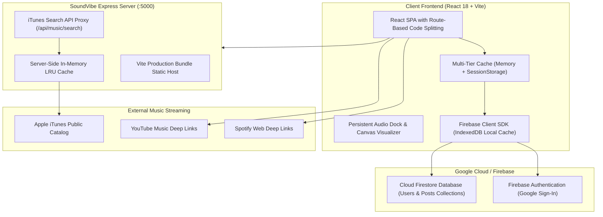

# 🎵 SoundVibe — Social Music Discovery & Community Taste Hub

<p align="center">
  
  
  
  
  
  
</p>

> **SoundVibe** is a high-performance social music taste discovery platform. It empowers listeners to share track reviews, stream audio previews with interactive canvas sound visualizers, compare 1-on-1 musical compatibility, and connect with other curators through an intuitive, taste-driven community feed.

---

## 📑 Table of Contents
- [✨ Key Features](#-key-features)
- [🏗️ System Architecture](#️-system-architecture)
- [⚡ Performance & Caching Engine](#-performance--caching-engine)
- [🛠️ Tech Stack](#️-tech-stack)
- [🚀 Quick Start & Installation](#-quick-start--installation)
- [🔐 Environment Variables](#-environment-variables)
- [📁 Project Structure](#-project-structure)
- [📚 Documentation](#-documentation)
- [📄 License](#-license)

---

## ✨ Key Features

### 1. 🔥 Social Vibe Feed & Music Reviews
- **Drop a Vibe**: Review singles and albums with 1–5 ⭐ ratings, mood tags, favorite lyric highlights, and `#vibeTags`.
- **Clustered Data Streaming**: Feed posts stream in clean clusters of 10 with a responsive **"Load More Vibes"** flow and end-of-feed completion markers.
- **Dynamic Relative Timestamps**: Smart timestamping (*"12m ago"*, *"Yesterday at 4:15 PM"*) with localized exact time tooltips.
- **Atomic Interactive Reactions**: 6 custom reactions (`🔥 Fire`, `🌊 Vibe`, `❤️ Love`, `🔁 On Repeat`, `🧠 Mindblown`, `😴 Overrated`) powered by atomic database operations.
- **Discussion Threads**: Interactive nested comments with inline editing and author-only deletion.
- **Feed Filters**: Switch seamlessly between *All Vibes*, *Following*, *Trending*, *Top Rated*, and genre pills (*Indie Rock*, *Synthwave*, *Psychedelic Pop*, *Neo-Soul*, etc.).

### 2. 🎧 Persistent Global Audio Dock & Visualizer
- **Uninterrupted Audio**: Audio playback continues seamlessly as you browse between feeds, search results, and curator profiles.
- **Interactive Scrubber & Volume**: Drag-to-seek waveform timeline, mute toggling, shuffle, and queue management drawer.
- **Live Canvas Audio Visualizer**: Real-time Web Audio API frequency visualizer featuring a glowing, spinning vinyl disc.

### 3. 🔍 Universal Music Search & Discovery Hub
- **Instant Track Autocomplete**: Search millions of songs and artists with live album art previews powered by a high-speed, keyless Apple iTunes Search proxy.
- **Direct External Streaming**: Direct 1-click launch links to **Spotify** and **YouTube Music** with touch-friendly mobile badges.
- **Multi-Category Discovery Hub**: Unified search (`/search?q=...`) filtering across **Songs & Tracks**, **Curators & Users**, **Vibe Reviews**, and **Vibe Tags**.

### 4. ⚡ Music Taste Compatibility Matcher
- **1-on-1 Sonic Frequency Analyzer**: Compare your music rotation against any community member.
- **Compatibility Score**: Calculates a musical affinity percentage (e.g., *94% Sonic Soulmates*) and reveals shared genres and favorite records.

### 5. 🛡️ Frictionless Google Authentication
- Streamlined 1-click **Google Sign-In** with instant profile provisioning.
- Customized profile bio, favorite genres, top tracks, and interactive followers/following network modals.

---

## 🏗️ System Architecture



---

## ⚡ Performance & Caching Engine

SoundVibe employs a multi-tiered architecture designed for instant response times and minimal network overhead:

1. **~95% Bundle Size Reduction**:
   - Implemented route-based dynamic code splitting via `React.lazy()` and `<Suspense>`.
   - The initial app shell download shrank from **1,165 kB** to just **62.1 kB**.
   - Vendor libraries are cleanly partitioned into long-term cacheable chunks (`vendor-react`, `vendor-firebase`, `vendor-icons`).

2. **Multi-Tier Music & Search Caching**:
   - **Client Cache (`cacheService.js`)**: Repeated track searches, previews, and tag lookups resolve in **0ms** from browser memory/session storage with zero network traffic.
   - **Server Cache (`MemoryCache`)**: Express implements an in-memory LRU TTL cache for track queries and trending music with HTTP `Cache-Control` and `X-SoundVibe-Cache: HIT` headers.

3. **Atomic Firestore Operations**:
   - Reactions use Firestore's native `arrayUnion` and `arrayRemove`, eliminating concurrent overwrite race conditions.
   - Follower lookups use targeted parallel document reads instead of downloading the entire user collection.

---

## 🛠️ Tech Stack

| Domain | Technologies |
| :--- | :--- |
| **Frontend Framework** | React 18.3, Vite 6.4, React Router v6 |
| **Styling & UI** | Tailwind CSS 3.4, Lucide React Icons, Glassmorphic Design System, Canvas Confetti |
| **Audio Engine** | Web Audio API (`AnalyserNode`), HTML5 Audio, Canvas 2D Waveform Engine |
| **Cloud Database** | Google Cloud Firestore (IndexedDB Persistent Local Cache, Rules Security) |
| **Authentication** | Firebase Authentication (Google Identity Provider) |
| **Backend Proxy** | Node.js, Express.js (In-Memory LRU Cache, iTunes Search Proxy) |
| **Caching Layer** | Client In-Memory Map, `sessionStorage`, Server-Side LRU TTL Store |

---

## 🚀 Quick Start & Installation

### Prerequisites
- **Node.js** (v18.0.0 or higher recommended)
- **npm** (v9.0.0 or higher)

### 1. Clone the Repository
```bash
git clone https://github.com/Jatin-nicon/soundvibe.git
cd soundvibe
```

### 2. Install Dependencies
```bash
npm install
npm --prefix client install
npm --prefix server install
```

### 3. Configure Environment Variables
Create a `.env` file in the `client/` directory:
```bash
cp client/.env.example client/.env
```
Populate your Firebase web configuration values (see [Environment Variables](#-environment-variables)).

### 4. Build & Start the Full-Stack Application
```bash
npm run build
npm start
```
Open **[http://localhost:5000](http://localhost:5000)** in your browser!

---

### 💻 Development Mode (Hot-Reloading)

To run the client and server concurrently with hot module replacement:

```bash
# Terminal 1: Backend Server (Port 5000)
npm run dev:server

# Terminal 2: Frontend Vite Dev Server (Port 3000)
npm run dev:client
```
Visit **[http://localhost:3000](http://localhost:3000)** for live HMR development.

---

## 🔐 Environment Variables

Create `client/.env` based on `client/.env.example`:

```env
# Firebase Client SDK Configuration
VITE_FIREBASE_API_KEY=your_firebase_api_key
VITE_FIREBASE_AUTH_DOMAIN=your_project_id.firebaseapp.com
VITE_FIREBASE_PROJECT_ID=your_project_id
VITE_FIREBASE_STORAGE_BUCKET=your_project_id.firebasestorage.app
VITE_FIREBASE_MESSAGING_SENDER_ID=your_messaging_sender_id
VITE_FIREBASE_APP_ID=your_app_id
VITE_FIREBASE_MEASUREMENT_ID=your_measurement_id
```

> [!NOTE]
> Song fetching via the Apple iTunes Search API requires **no API key** — it runs keylessly out of the box through the Express proxy.

---

## 📁 Project Structure

```
soundvibe/
├── client/                      # React 18 Frontend Application
│   ├── dist/                    # Compiled production build assets
│   ├── src/
│   │   ├── components/          # Reusable UI components
│   │   │   ├── Navbar.jsx       # Header with global search autocomplete
│   │   │   ├── PlayerBar.jsx    # Persistent bottom audio player dock
│   │   │   ├── PostCard.jsx     # Review card with reactions & streaming
│   │   │   ├── AudioVisualizerModal.jsx # Fullscreen vinyl waveform canvas
│   │   │   ├── YouTubePlayerModal.jsx   # YouTube Music streaming modal
│   │   │   ├── AuthModal.jsx    # Google Sign-In authentication modal
│   │   │   └── ...
│   │   ├── context/             # Global React Context providers
│   │   │   ├── AudioPlayerContext.jsx # Web Audio player state engine
│   │   │   └── AuthContext.jsx        # Firebase Auth & profile session
│   │   ├── pages/               # Lazy-loaded page route components
│   │   │   ├── FeedPage.jsx     # Clustered social vibe feed
│   │   │   ├── SearchPage.jsx   # Multi-category discovery hub
│   │   │   ├── ProfilePage.jsx  # Curator profile & compatibility
│   │   │   ├── CreatePostPage.jsx # Review composer & music picker
│   │   │   └── ...
│   │   ├── services/
│   │   │   ├── cacheService.js     # High-speed client cache store
│   │   │   └── firestoreService.js # Firestore atomic operations & queries
│   │   ├── firebase.js          # Firebase SDK initialization & IndexedDB cache
│   │   └── App.jsx              # Application router & code splitting
│   ├── vite.config.js           # Vite config with manual chunking
│   └── package.json
│
├── server/                      # Node.js Express Backend
│   ├── src/
│   │   ├── routes.js            # Cached music search proxy & API routes
│   │   └── index.js             # Express entry point & static server
│   └── package.json
│
├── firestore.rules              # Cloud Firestore Security Rules
├── firestore.indexes.json       # Composite query index definitions
├── PROJECT.md                   # Detailed project architecture & schemas
├── API.md                       # REST endpoints & service reference
├── CONTRIBUTING.md              # Setup & code contribution guidelines
└── package.json                 # Monorepo task orchestration scripts
```

---

## 📚 Documentation

- 📖 **[PROJECT.md](./PROJECT.md)**: Deep dive into data models, system design, and product philosophy.
- 📡 **[API.md](./API.md)**: REST endpoint specifications, query parameters, and cache headers.
- 🤝 **[CONTRIBUTING.md](./CONTRIBUTING.md)**: Branching models, PR workflows, and code standards.

---

## 📄 License

This project is licensed under the **MIT License** — feel free to use, modify, and distribute it for personal and commercial projects.
